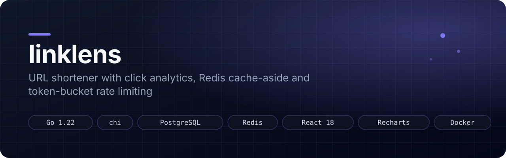
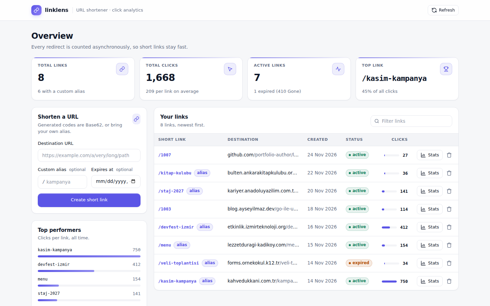
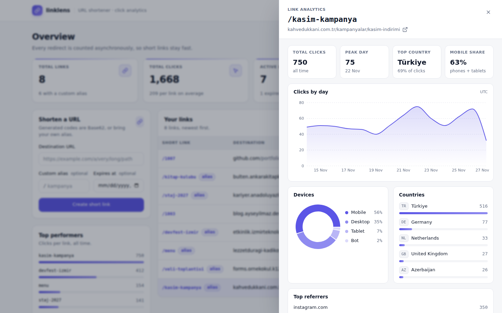
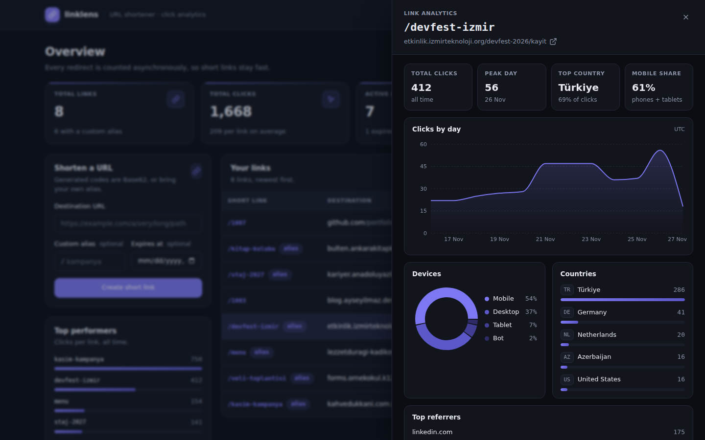
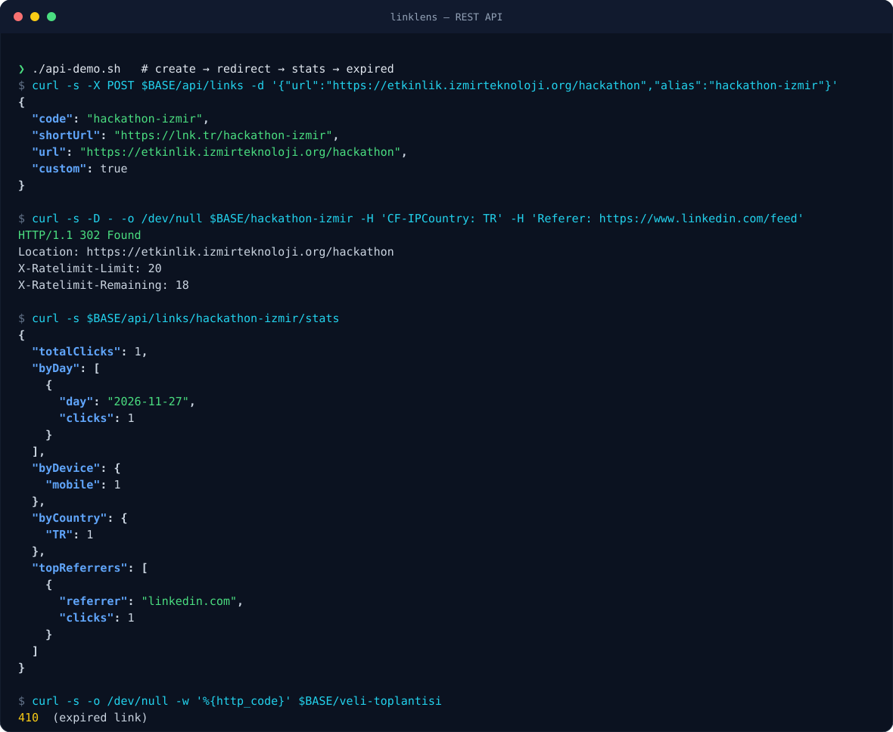
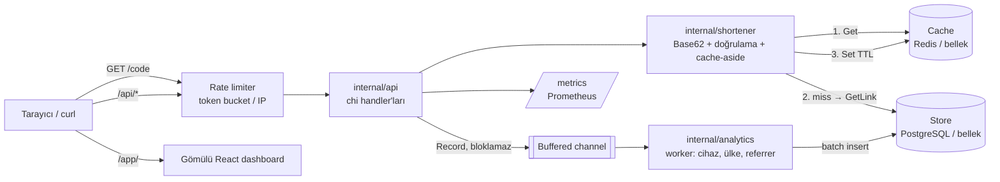
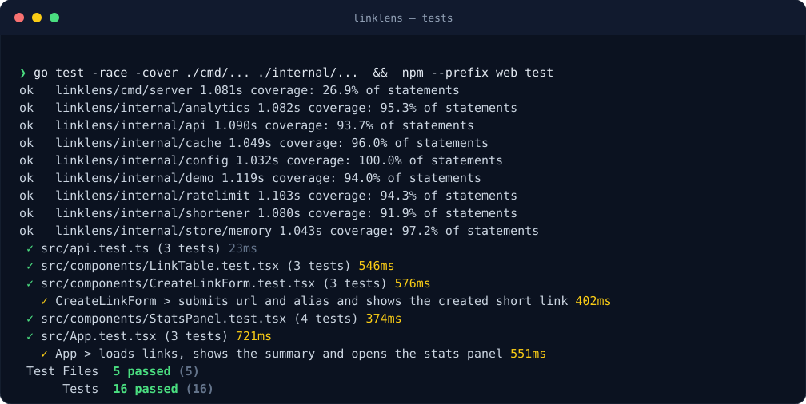
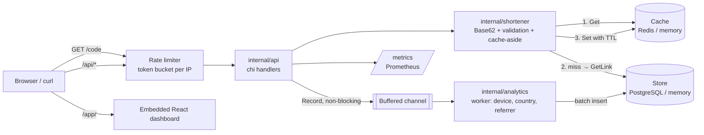

# linklens

[](https://github.com/sorcerermedic/linklens/actions/workflows/ci.yml)


> A URL shortener with click analytics, Redis cache-aside lookups and per-IP token-bucket rate limiting, shipped as a single Go binary with an embedded React dashboard.

<p align="center"></p>
<p align="center">
  
  
</p>
<p align="center">
  
  
</p>

### Highlights

- ⚡ **Fast redirects:** cache-aside lookups (Redis or memory) and a non-blocking analytics channel keep the 302 path free of database writes.
- 📊 **Real click analytics:** per-day trend, device split, country and referrer rankings in a React + Recharts dashboard embedded in the Go binary.
- 🛡️ **Abuse-resistant:** per-IP token bucket (atomic Lua script on Redis), SSRF-safe URL validation, 410 Gone for expired links.
- 🧪 **Runs anywhere:** zero external services needed for tests or local runs; `DEMO_SEED=true` loads Turkish demo links with 14 days of traffic.
- 🐳 **Production shape:** PostgreSQL + Redis via Docker Compose, Prometheus `/metrics`, distroless image, GitHub Actions CI.

## 🇹🇷 Türkçe

### Nedir?

**linklens**, uzun URL'leri kısa kodlara çeviren ve her tıklamayı analiz eden bir URL kısaltma servisidir. Go ile yazılmış HTTP API; kısa link oluşturma, yönlendirme (302), tıklama istatistikleri (gün, cihaz, ülke, referrer) ve Prometheus metrikleri sunar. React + TypeScript ile yazılmış dashboard derlenip Go binary'sinin içine gömülür ve `/app/` altında servis edilir.

### Neden yaptım?

URL kısaltıcı "basit" görünen ama gerçek bir backend'in tüm temel konularını içeren bir problem: veritabanı sekansından çakışmasız kod üretimi, sık okunan veri için cache-aside, kötüye kullanıma karşı rate limiting, istek yolunu yavaşlatmadan asenkron analitik toplama, güvenli girdi doğrulama (SSRF/açık yönlendirme riskleri) ve gözlemlenebilirlik. Bu projeyi bu konuları küçük, test edilebilir ve arayüzlerle ayrılmış paketlerle uygulamak için yaptım.

### Mimari



| Paket | Sorumluluk |
|---|---|
| `cmd/server` | Konfigürasyon, bağımlılıkların seçimi (Postgres/Redis ya da bellek), graceful shutdown |
| `internal/shortener` | Base62 kodlama, URL/alias doğrulama, cache-aside çözümleme, süre dolumu |
| `internal/store` | `Store` arayüzü; `postgres` (pgx, gömülü migration) ve `memory` implementasyonları |
| `internal/cache` | `Cache` arayüzü; `redis` ve `memory` (TTL + periyodik temizlik) |
| `internal/ratelimit` | Token bucket algoritması; bellek ve Redis (atomik Lua script) backend'leri, HTTP middleware |
| `internal/analytics` | User-Agent → cihaz, `CF-IPCountry`/gömülü IP tablosu → ülke, referrer normalizasyonu, batch yazan asenkron worker |
| `internal/api` | HTTP handler'ları, hata → durum kodu eşlemesi, metrik middleware'i, SPA servisi |
| `internal/metrics` | Prometheus sayaç ve histogramları |
| `internal/demo` | `DEMO_SEED=true` için deterministik Türkçe demo linkleri ve 14 günlük tıklama geçmişi |
| `web/` | React 18 + Vite + Recharts dashboard |

### Özellikler

- `POST /api/links` — URL'yi kısaltır; opsiyonel özel `alias` ve `expiresAt`.
- `GET /{code}` — 302 yönlendirme; tıklama asenkron kaydedilir. Süresi dolmuş link → **410 Gone**, olmayan → 404.
- `GET /api/links` — tüm linkler, tıklama sayılarıyla (en yeni önce).
- `GET /api/links/{code}/stats` — `totalClicks`, `byDay[]`, `byDevice{}`, `byCountry{}`, `topReferrers[]`.
- `DELETE /api/links/{code}` — link, tıklamaları ve cache girdisiyle birlikte silinir.
- `GET /healthz` — store ve cache bağlantı kontrolü (sorun varsa 503).
- `GET /metrics` — istek sayısı/gecikme (route pattern bazında), cache hit/miss, redirect, 429, kaydedilen/düşürülen tıklama.
- **Çakışmasız kod üretimi:** veritabanı sekans id'si + sabit ofset → Base62 (en az 4 karakter).
- **Cache-aside:** miss → store → TTL ile cache'e yaz → sonraki istekler hit. Süre dolumu her istekte kontrol edilir, böylece cache'teki eski kayıt süresi dolmuş linki asla yönlendirmez.
- **Rate limiting:** IP başına token bucket; `X-RateLimit-*` ve `Retry-After` başlıkları; Redis ile birden çok instance aynı kovayı paylaşır; backend hatasında *fail-open*.
- **URL doğrulama:** sadece http/https; localhost, `.local`, tek etiketli host'lar, özel/loopback/link-local IP'ler ve URL içinde kimlik bilgisi reddedilir (DNS sorgusu yapmadan).
- **Tek binary:** dashboard `embed` ile Go binary'sine gömülür; Postgres/Redis tanımlı değilse bellek içi implementasyonlarla sıfır bağımlılıkla çalışır.
- **Dashboard:** özet KPI kartları (toplam link, tıklama, aktif link, en iyi link), kopyalama butonlu link oluşturma formu, filtrelenebilir link tablosu, "en iyi performans" sıralaması ve her link için yan panelde analitik (günlük trend, cihaz dağılımı, ülke ve referrer sıralaması). Panel `#/stats/<kod>` ile doğrudan açılabilir; açık/koyu tema sistem tercihini izler.
- **Demo verisi:** `DEMO_SEED=true` bellek içi store'a 8 Türkçe demo link ve son 14 güne yayılmış ~1.700 tıklama yükler (deterministik).

### Hızlı başlangıç

Tam yığın (uygulama + PostgreSQL + Redis):

```bash
docker compose up --build
# Dashboard: http://localhost:8080/app/
```

Harici servis olmadan (Go 1.22+ ve Node 20+ gerekir):

```bash
make run     # dashboard'u derler, sunucuyu :8080'de bellek içi backend'lerle başlatır
DEMO_SEED=true make run   # aynısı, demo linkleri ve 14 günlük tıklama geçmişiyle
```

Tüm ayarlar `.env.example` içinde açıklanmıştır.

### Kullanım örnekleri

Gerçek bir oturum (oluştur → yönlendir → istatistik → süresi dolmuş link):

<p align="center"></p>

```bash
# Kısa link oluştur
$ curl -s -X POST localhost:8080/api/links \
    -H 'Content-Type: application/json' \
    -d '{"url":"https://go.dev/doc","alias":"go-docs"}'
{"code":"go-docs","shortUrl":"http://localhost:8080/go-docs","url":"https://go.dev/doc","custom":true,"createdAt":"2026-11-27T12:53:07.946Z","expired":false,"clicks":0}

# Otomatik kod + son kullanma tarihi
$ curl -s -X POST localhost:8080/api/links -d '{"url":"https://example.com","expiresAt":"2027-01-01T00:00:00Z"}'
{"code":"1001","shortUrl":"http://localhost:8080/1001", ...}

# Yönlendirme
$ curl -s -o /dev/null -w '%{http_code} %{redirect_url}\n' -A 'Mozilla/5.0 (iPhone; Mobile)' -e https://github.com/x localhost:8080/go-docs
302 https://go.dev/doc

# İstatistikler
$ curl -s localhost:8080/api/links/go-docs/stats
{"totalClicks":1,"byDay":[{"day":"2026-11-27","clicks":1}],"byDevice":{"mobile":1},"byCountry":{"unknown":1},"topReferrers":[{"referrer":"github.com","clicks":1}]}

# Hatalı istekler
$ curl -s -X POST localhost:8080/api/links -d '{"url":"http://192.168.1.1/admin"}'
{"error":"urls pointing at localhost or private networks are not allowed"}

# Metrikler
$ curl -s localhost:8080/metrics | grep linklens_redirects_total
linklens_redirects_total 1
```

### Testler

```bash
make test               # go test -race ./... + vitest (harici servis gerekmez)
make lint               # gofmt, go vet, eslint, tsc --noEmit
make bench              # BenchmarkRedirect (bellek içi implementasyonlar)

docker compose up -d postgres
INTEGRATION=1 make test-integration   # gerçek PostgreSQL'e karşı store testleri
```

<p align="center"></p>

- Base62, URL/alias doğrulama, rate limiter (enjekte edilen sahte saat ile), cache-aside (miss → doldur → hit → TTL sonrası miss) için tablo güdümlü testler.
- Redis tabanlı cache ve rate limiter `miniredis` ile ağ olmadan test edilir; aynı senaryolar her iki backend'de koşar.
- Handler'lar `httptest` ve bellek içi store ile; uçtan uca test gerçek asenkron worker ile oluştur → yönlendir → flush → istatistik akışını doğrular.
- `cmd/server` testi gerçek kablolamayı rastgele portta (`:0`) ayağa kaldırır ve graceful shutdown'u doğrular.
- PostgreSQL testleri `//go:build integration` etiketlidir; `INTEGRATION=1` ve `DATABASE_URL` yoksa atlanır. CI'da Postgres servisiyle koşar.
- Demo seed'i deterministiktir ve testlerle doğrulanır (link sayısı, tıklama toplamları, süresi dolmuş link).
- Frontend: vitest + Testing Library ile form, tablo filtresi, istatistik paneli (Escape ile kapanma dahil), `App` (deep link dahil) ve API istemcisi testleri.

### Tasarım kararları

- **Sekans + Base62 (hash değil):** kodlar yapı gereği benzersizdir, çakışma kontrolü için rastgele deneme gerekmez. Ofset (62³) kısa ve tahmin edilebilir kodları önler. Özel alias'ın, üretilecek bir kodu önceden almış olması ihtimali için sınırlı bir yeniden deneme döngüsü vardır.
- **Arayüzler + bellek içi implementasyonlar:** `Store` ve `Cache` arayüzleri sayesinde testler ve yerel geliştirme hiçbir servis gerektirmez; production'da aynı kod Postgres/Redis ile çalışır.
- **Negatif sonuçlar cache'lenmez:** olmayan kodlar için store'a gidilir; bu, yeni oluşturulan linklerin anında çalışmasını sağlar (bilinçli bir takas, bkz. sınırlamalar).
- **Asenkron analitik:** redirect yolu sadece kanala bloklamadan yazar. Kanal doluysa olay düşürülür ve `linklens_clicks_dropped_total` artar — redirect gecikmesi analitikten önemlidir. Worker batch halinde yazar; kapanışta önce HTTP sunucusu durur, sonra kalan olaylar flush edilir.
- **Redis rate limiter'da Lua script:** okuma-hesaplama-yazma atomik olur, eşzamanlı isteklerde token çift harcanmaz. Algoritma Go tarafındaki `take` fonksiyonunun birebir karşılığıdır ve aynı test senaryolarıyla doğrulanır.
- **Metriklerde route pattern etiketi:** `/{code}` gibi yüksek kardinaliteli yollar tek seri olarak toplanır.
- **Redirect'te `Cache-Control: no-store`:** tarayıcı 302'yi cache'lerse tekrar eden tıklamalar sayılmaz.

### Bilinen sınırlamalar

- IP → ülke eşlemesi bilerek küçük bir **stub** tablodur (birkaç bilinen DNS aralığı). Gerçek kullanımda CDN'in `CF-IPCountry` başlığına güvenilir; aksi halde çoğu tıklama `unknown` görünür.
- Cihaz tespiti basit User-Agent kalıplarıyla yapılır; tam bir UA parser değildir.
- Kimlik doğrulama yoktur: API'ye erişebilen herkes link oluşturup silebilir. Dashboard herkese açık kullanım için değil, dahili/kişisel kullanım içindir.
- URL doğrulaması DNS çözümlemesi yapmaz; özel bir IP'ye çözümlenen herkese açık bir alan adı reddedilmez.
- Olmayan kodlar cache'lenmediği için rastgele kodlarla yapılan istekler veritabanına ulaşır (rate limiter bunu sınırlar).
- Bellek içi store'da veriler yeniden başlatmada kaybolur; tıklama olayları ham satır olarak saklanır (ön-toplama yok).
- `TRUST_PROXY=true` sadece güvenilen bir reverse proxy arkasında açılmalıdır; aksi halde `X-Forwarded-For` taklit edilerek rate limit atlatılabilir.

### Yol haritası (Roadmap)

- [ ] API anahtarı / kullanıcı hesapları ve link sahipliği
- [ ] Gerçek GeoIP veritabanı (MaxMind GeoLite2) entegrasyonu
- [ ] Negatif cache (kısa TTL) ve Bloom filter ile olmayan kodları hızlı reddetme
- [ ] Tıklamaları günlük tablolara ön-toplama ve eski ham olayları arşivleme
- [ ] QR kod üretimi, link düzenleme, toplu oluşturma
- [ ] Dashboard'da sayfalama ve tarih aralığı filtresi
- [ ] Recharts'ı lazy-load ederek dashboard bundle boyutunu küçültme
- [ ] OpenAPI şeması ve Grafana dashboard'u

## 🇬🇧 English

### What is it?

**linklens** is a URL shortening service that turns long URLs into short codes and analyses every click. The Go HTTP API provides link creation, redirects (302), click statistics (per day, device, country and referrer) and Prometheus metrics. A React + TypeScript dashboard is compiled and embedded into the Go binary and served under `/app/`.

### Why I built it

A URL shortener looks "simple" but touches every core backend topic: collision-free code generation from a database sequence, cache-aside for hot reads, rate limiting against abuse, asynchronous analytics that never slow down the request path, safe input validation (SSRF / open-redirect concerns) and observability. I built it to implement those ideas as small, testable packages separated by interfaces.

### Architecture



| Package | Responsibility |
|---|---|
| `cmd/server` | Configuration, choosing backends (Postgres/Redis or memory), graceful shutdown |
| `internal/shortener` | Base62 encoding, URL/alias validation, cache-aside resolution, expiry |
| `internal/store` | `Store` interface; `postgres` (pgx, embedded migrations) and `memory` implementations |
| `internal/cache` | `Cache` interface; `redis` and `memory` (TTL + periodic sweep) |
| `internal/ratelimit` | Token-bucket algorithm; memory and Redis (atomic Lua script) backends, HTTP middleware |
| `internal/analytics` | User-Agent → device, `CF-IPCountry`/embedded IP table → country, referrer normalisation, batching async worker |
| `internal/api` | HTTP handlers, error → status mapping, metrics middleware, SPA serving |
| `internal/metrics` | Prometheus counters and histograms |
| `internal/demo` | Deterministic Turkish demo links with 14 days of click history for `DEMO_SEED=true` |
| `web/` | React 18 + Vite + Recharts dashboard |

### Features

- `POST /api/links` — shorten a URL; optional custom `alias` and `expiresAt`.
- `GET /{code}` — 302 redirect; the click is recorded asynchronously. Expired link → **410 Gone**, unknown → 404.
- `GET /api/links` — all links with click totals (newest first).
- `GET /api/links/{code}/stats` — `totalClicks`, `byDay[]`, `byDevice{}`, `byCountry{}`, `topReferrers[]`.
- `DELETE /api/links/{code}` — removes the link, its clicks and its cache entry.
- `GET /healthz` — store and cache connectivity (503 when degraded).
- `GET /metrics` — request count/latency (by route pattern), cache hits/misses, redirects, 429s, recorded/dropped clicks.
- **Collision-free codes:** database sequence id + fixed offset → Base62 (at least 4 characters).
- **Cache-aside:** miss → store → write to cache with TTL → subsequent requests hit. Expiry is checked on every request, so a cached entry never redirects an expired link.
- **Rate limiting:** token bucket per IP; `X-RateLimit-*` and `Retry-After` headers; with Redis several instances share the same buckets; fails open if the backend is down.
- **URL validation:** http/https only; rejects localhost, `.local`, single-label hosts, private/loopback/link-local IPs and embedded credentials (without any DNS lookups).
- **Single binary:** the dashboard is embedded with `embed`; without Postgres/Redis configured the server runs with in-memory implementations and zero dependencies.
- **Dashboard:** KPI cards (total links, clicks, active links, top link), a create form with copy-to-clipboard, a filterable links table, a "top performers" ranking and a per-link analytics sheet (daily trend, device split, country and referrer rankings). The sheet is deep-linkable via `#/stats/<code>`; light/dark theme follows the system preference.
- **Demo data:** `DEMO_SEED=true` loads 8 Turkish demo links and ~1,700 clicks spread over the last 14 days into the in-memory store (deterministic).

### Quick start

Full stack (app + PostgreSQL + Redis):

```bash
docker compose up --build
# Dashboard: http://localhost:8080/app/
```

Without any external services (requires Go 1.22+ and Node 20+):

```bash
make run     # builds the dashboard and starts the server on :8080 with in-memory backends
DEMO_SEED=true make run   # same, with demo links and 14 days of click history
```

Every setting is documented in `.env.example`.

### Usage examples

A real session (create → redirect → stats → expired link):

<p align="center"></p>

```bash
# Create a short link
$ curl -s -X POST localhost:8080/api/links \
    -H 'Content-Type: application/json' \
    -d '{"url":"https://go.dev/doc","alias":"go-docs"}'
{"code":"go-docs","shortUrl":"http://localhost:8080/go-docs","url":"https://go.dev/doc","custom":true,"createdAt":"2026-11-27T12:53:07.946Z","expired":false,"clicks":0}

# Generated code + expiry
$ curl -s -X POST localhost:8080/api/links -d '{"url":"https://example.com","expiresAt":"2027-01-01T00:00:00Z"}'
{"code":"1001","shortUrl":"http://localhost:8080/1001", ...}

# Redirect
$ curl -s -o /dev/null -w '%{http_code} %{redirect_url}\n' -A 'Mozilla/5.0 (iPhone; Mobile)' -e https://github.com/x localhost:8080/go-docs
302 https://go.dev/doc

# Statistics
$ curl -s localhost:8080/api/links/go-docs/stats
{"totalClicks":1,"byDay":[{"day":"2026-11-27","clicks":1}],"byDevice":{"mobile":1},"byCountry":{"unknown":1},"topReferrers":[{"referrer":"github.com","clicks":1}]}

# Rejected input
$ curl -s -X POST localhost:8080/api/links -d '{"url":"http://192.168.1.1/admin"}'
{"error":"urls pointing at localhost or private networks are not allowed"}

# Metrics
$ curl -s localhost:8080/metrics | grep linklens_redirects_total
linklens_redirects_total 1
```

### Tests

```bash
make test               # go test -race ./... + vitest (no external services)
make lint               # gofmt, go vet, eslint, tsc --noEmit
make bench              # BenchmarkRedirect (in-memory implementations)

docker compose up -d postgres
INTEGRATION=1 make test-integration   # store tests against a real PostgreSQL
```

<p align="center"></p>

- Table-driven tests for Base62, URL/alias validation, the rate limiter (with an injected fake clock) and cache-aside (miss → fill → hit → miss after TTL).
- The Redis-backed cache and rate limiter are tested with `miniredis`, without network access; the same scenarios run against both backends.
- Handlers are tested with `httptest` and the memory store; an end-to-end test drives create → redirect → flush → stats through the real asynchronous worker.
- The `cmd/server` test boots the real wiring on a random port (`:0`) and verifies graceful shutdown.
- PostgreSQL tests carry the `//go:build integration` tag and skip unless `INTEGRATION=1` and `DATABASE_URL` are set. CI runs them against a Postgres service container.
- The demo seed is deterministic and covered by tests (link count, click totals, expired link).
- Frontend: vitest + Testing Library tests for the form, table filter, stats sheet (including Escape to close), `App` (including deep links) and the API client.

### Design decisions

- **Sequence + Base62 (not hashing):** codes are unique by construction, so no random retry loop is needed for collisions. The offset (62³) avoids very short, trivially enumerable codes. A bounded retry handles the edge case where a custom alias already took a code the sequence would produce.
- **Interfaces + in-memory implementations:** the `Store` and `Cache` interfaces let tests and local development run without services, while production uses the same code with Postgres/Redis.
- **No negative caching:** unknown codes go to the store, so freshly created links work instantly (a deliberate trade-off, see limitations).
- **Asynchronous analytics:** the redirect path only does a non-blocking channel send. When the buffer is full the event is dropped and `linklens_clicks_dropped_total` increments — redirect latency matters more than analytics. The worker writes in batches; on shutdown the HTTP server stops first, then the remaining events are flushed.
- **Lua script for the Redis limiter:** read-compute-write is atomic, so concurrent requests never double-spend a token. It mirrors the Go `take` function and is verified by the same test scenarios.
- **Route pattern as metric label:** high-cardinality paths like `/{code}` collapse into a single series.
- **`Cache-Control: no-store` on redirects:** if browsers cached the 302, repeat clicks would not be counted.

### Known limitations

- IP → country lookup is intentionally a tiny **stub** table (a few well-known DNS ranges). Real deployments should rely on a CDN's `CF-IPCountry` header; otherwise most clicks show up as `unknown`.
- Device detection uses simple User-Agent patterns, not a full UA parser.
- There is no authentication: anyone who can reach the API can create and delete links. The dashboard is meant for internal/personal use.
- URL validation does not resolve DNS; a public hostname that resolves to a private IP is not rejected.
- Unknown codes are not cached, so requests for random codes reach the database (bounded by the rate limiter).
- The in-memory store loses data on restart; click events are stored as raw rows (no pre-aggregation).
- `TRUST_PROXY=true` must only be enabled behind a trusted reverse proxy; otherwise `X-Forwarded-For` can be spoofed to bypass rate limiting.

### Roadmap

- [ ] API keys / user accounts and link ownership
- [ ] Real GeoIP database (MaxMind GeoLite2) integration
- [ ] Negative caching (short TTL) and a Bloom filter to reject unknown codes fast
- [ ] Pre-aggregate clicks into daily tables and archive old raw events
- [ ] QR codes, link editing, bulk creation
- [ ] Pagination and date-range filters in the dashboard
- [ ] Lazy-load Recharts to shrink the dashboard bundle
- [ ] OpenAPI schema and a Grafana dashboard

## License

MIT
